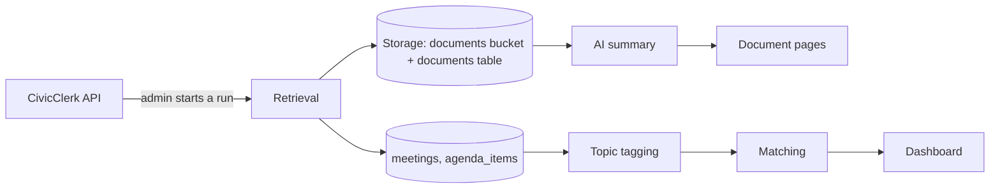

<div align="center">

# 🏛️ Civic Radar

**Know what your local government is deciding.**

[](https://nextjs.org/)
[](https://react.dev/)
[](https://www.typescriptlang.org/)
[](https://supabase.com/)
[](https://tailwindcss.com/)
[](https://vitest.dev/)
[](https://civic-radar.onrender.com)

</div>

<a id="about"></a>
## About 🏛️

Civic Radar collects local government meeting records and published documents, summarizes the documents with AI, and lets residents follow the towns and topics they care about, so they don't have to check every town portal themselves. It is for residents who want to keep up with their town government, and for the people who help them, such as journalists and community groups. It began as a team project for CSC 351 at Salem State University, and the team intends to keep building it into a full public website after the course ends.

**Live site:** https://civic-radar.onrender.com

Salem, MA is the pilot town. Meetings and documents come from each town's CivicClerk portal.

## Contents

- [About](#about)
- [Highlights](#highlights)
- [Features](#features)
- [Team](#team)
- [Tech stack](#tech-stack)
- [Architecture](#architecture)
- [Data](#data)
- [Getting started](#getting-started)
- [Deployment](#deployment)
- [Conventions](#conventions)
- [Contributing](#contributing)
- [Roadmap and limitations](#roadmap)
- [Status](#status)
- [License](#license)

---

<a id="highlights"></a>
## Highlights

These are the three promises on the landing page ([app/page.tsx](app/page.tsx)), with what the code supports today.

### 📅 Meetings that matter to you

Residents follow towns and topics, and the dashboard lists the meetings in their followed towns that carry one of their followed topic tags, plus any meeting they follow directly (SRS-401.1, SRS-401.6, SRS-101.4, SRS-404.1). Each meeting shows why it matched (SRS-401.5, in progress). Topic tags come from agenda text, so a meeting can only match on topic after its agenda items are retrieved and tagged (see [Limitations](#limitations)).

### 📄 Documents in plain language

Each retrieved document gets an AI summary of at most 150 words (SRS-204.1, SRS-NFR-7), shown above the in-page PDF (SRS-205.1, SRS-203.2) with an AI-generated disclaimer (SRS-204.4). The meeting page links each document to its original source on CivicClerk (SRS-502.4, SRS-502.9). A source link on the document page itself (SRS-207) is not built yet. TODO: confirm, the document API already returns `source_url` but the page does not show it.

### 🔔 Alerts before you miss it

**Planned.** Meeting alerts, change alerts, record-available alerts and the weekly email digest are specified in SRS-402 to SRS-408. The database tables exist in [supabase/schema.sql](supabase/schema.sql), but no alert or email code exists yet, and no SRS item for them is on the board.

---

<a id="features"></a>
## Features 🌿

Features are grouped by the SRS user requirement ranges. Each row lists the SRS items that are on the project board, with their board status. The full text of every item is in the [SRS](docs/requirements/Civic%20Radar%20System%20Requirements%20(v2).md).

Legend: 🌱 Planned · 🌿 In progress · 🌳 Done. "Not on the board" means the SRS defines the requirement but no issue tracks it yet.

### Accounts, setup and towns (1xx, KJ)

| Requirement | SRS items and status |
| :-- | :-- |
| UR-101 Topic selection | 🌳 101.4 Saved topic preferences · 🌳 101.5 Initial topic catalog¹ · 🌱 101.7 Resident catalog restriction¹ |
| UR-102 Data freshness | 🌱 102.1 Last check time display |
| UR-104 Catalog management | 🌳 104.1 Catalog management access · 🌳 104.4 Catalog entry removal · 🌳 104.6 Town source settings · 🌱 104.2 Catalog entry creation · 🌱 104.3 Catalog entry modification |
| UR-107 First-time setup | 🌳 107.1 Setup start · 🌳 107.2 Setup next step · 🌳 107.3 Setup skip · 🌳 107.4 Setup completion |
| UR-103, UR-105, UR-106, UR-108 | Organization permissions, account activity history, account suspension, shared organization follows: not on the board |

¹ On the board but not in SRS v2. TODO: confirm whether SRS-101.5 and SRS-101.7 should be added to the SRS.

### Document and meeting retrieval, storage and AI summaries (2xx, MS)

| Requirement | SRS items and status |
| :-- | :-- |
| UR-201 Document list view | 🌳 201.1 Followed-towns list |
| UR-203 Open document PDF | 🌳 203.1 Open document detail page · 🌳 203.2 In-page PDF display |
| UR-204 View document summary | 🌳 204.1 Summary generation start · 🌳 204.2 Summary display · 🌳 204.4 AI-generated disclaimer |
| UR-205 Summary placement | 🌳 205.1 Summary positioned above PDF |
| UR-208 Automatic document updates | 🌳 208.2 New document added · 🌳 208.3 Duplicate entry prevention · SRS-208.1 Scheduled source check: not on the board, not built |
| UR-212 Document town tag | 🌳 212.1 Town tag in list |
| UR-220 Retrieve meetings | 🌳 220.1 Complete meeting retrieval · 🌳 220.3 Meeting details storage · 🌳 220.7 Meeting-document link · 🌳 220.9 Agenda item retrieval |
| UR-222 Report source check status | 🌳 222.1 Check time record |
| UR-202, 206, 207, 209 to 211, 213 to 219, 221 | Identification, pending and failed badges, sort order, multi-town scope, download, retrieval time, title search, summarization progress, meeting refresh: not on the board |

### Extraction of officials and contacts (3xx, AO)

| Requirement | SRS items and status |
| :-- | :-- |
| UR-301 Request contact extraction | 🌳 301.4 Extraction request · 🌿 301.7 Daily extraction limit¹ · 🌿 301.8 Extractable documents¹ |
| UR-302 to UR-307 | 🌳 302.1 Extracted official details · 🌳 303.2 Source document link · 🌳 304.1 Saved extraction list · 🌳 305.2 Deletion confirmation · 🌳 305.4 Permanent deletion · 🌳 306.1 Extraction status display · 🌳 307.2 Known failure cause |
| UR-310 Protect extraction records | 🌳 310.2 Ownership check |
| UR-311 Shared officials list | 🌳 311.1 View officials list · 🌳 311.2 Merge repeated officials |
| UR-308, UR-309 | Missing information indicator, contact search: not on the board |

¹ On the board but not in SRS v2. TODO: confirm whether SRS-301.7 and SRS-301.8 should be added to the SRS.

### Topics, tagging, matching and alerts (4xx, EG)

| Requirement | SRS items and status |
| :-- | :-- |
| UR-401 See meetings relevant to me | 🌳 401.1 Topic-and-town matching · 🌳 401.4 Topic tagging · 🌳 401.6 Save followed towns · 🌳 401.7 Town choices display · 🌿 401.2 Changed preferences applied · 🌿 401.5 Matching reason · 🌿 401.8 Setup message · 🌱 401.3 Complete empty result · 🌱 401.10 Unavailable classification · 🌱 401.11 Incomplete matching result |
| UR-404 Follow a specific meeting | 🌳 404.1 Follow a meeting · 🌳 404.2 Unfollow a meeting · 🌿 404.7 First baseline · 🌱 404.5 Comparison baseline update · 🌱 404.6 Update record · 🌱 404.9 Baseline kept on failed check |
| UR-402, 403, 405 to 408 | Meeting alerts, record alerts, duplicate prevention, email choices, pause and weekly digest: not on the board, not built |

### Dashboard and detail pages (5xx, YA)

| Requirement | SRS items and status |
| :-- | :-- |
| UR-501 Dashboard | 🌳 501.2 Dashboard item details · 🌳 501.3 Dashboard item selection · 🌿 501.1 Relevant meetings display · 🌿 501.5 Empty dashboard message · 🌱 501.4 Incomplete check label |
| UR-502 Meeting details | 🌳 502.4 Meeting document list · 🌳 502.5 No documents message · 🌳 502.8 Unsupported feature label |
| UR-506, UR-507 Search | 🌱 506.1 Search input · 🌱 506.2 Search submission · 🌱 507.1 Search results display. The Search page is a placeholder today. |
| UR-510 Navigation | 🌳 510.1 Primary navigation display · 🌳 510.2 Navigation destination |
| UR-511 Responsive interface | 🌳 511.1 Layout across screen widths · 🌳 511.2 Navigation on small screens |
| UR-503 to 505, 508, 509 | Meeting update history, officials directory, official information, AI letter drafting: not on the board |

---

<a id="team"></a>
## Team 🌳

Initials match the SRS owners and the issue titles.

| Member | Initials | Area |
| :-- | :-- | :-- |
| Kailun Ju | KJ | Accounts, setup, topic selection and the towns catalog (1xx) |
| Marcos Salazar | MS | Document and meeting retrieval, storage and AI summaries (2xx) |
| Aderly Ortiz | AO | Extraction of officials and contacts (3xx) |
| Erick Gonzalez | EG | Topics, tagging, matching and alerts (4xx) |
| Yolanda Ampomah | YA | Dashboard, detail pages, navigation and search (5xx) |

---

<a id="tech-stack"></a>
## Tech stack 🍃

Versions are from [package.json](package.json).

| Layer | Technology |
| :-- | :-- |
| Framework | Next.js 14.2.15 (App Router), React 18.3.1, React DOM 18.3.1 |
| Language | TypeScript 5.6.3 (strict) |
| Styling | Tailwind CSS 3.4.16, PostCSS 8.4.49, Autoprefixer 10.4.20, theme tokens in [app/globals.css](app/globals.css) |
| Icons | lucide-react ^1.55.0 |
| Database, auth, file storage | Supabase through @supabase/supabase-js ^2.45.4 |
| AI | Claude API: @anthropic-ai/sdk 0.131.0 for summaries, direct HTTPS calls for contact extraction |
| Tests | Vitest 2.1.8 (Node environment) |
| CI | GitHub Actions on Node 22 ([.github/workflows/ci.yml](.github/workflows/ci.yml)) |
| Hosting | Render web service |

---

<a id="architecture"></a>
## Architecture 🌲

### How a document reaches a resident



1. **Retrieval.** A system administrator opens `/admin/retrieval` and runs one town or all towns. `POST /api/retrieval/meetings` checks the role and calls `runTownRetrieval` ([lib/retrieval/runTownRetrieval.ts](lib/retrieval/runTownRetrieval.ts)). It opens a `source_checks` row, reads the town's meetings from CivicClerk (at most `RETRIEVAL_MAX_PAGES` pages), and upserts them into `meetings`. When the town's `provides_agenda_items` flag is true, it also saves agenda items.
2. **Storage.** For each file listed under a meeting, the run skips files already retrieved, downloads the rest, hashes them, uploads them to the private `documents` Storage bucket at `<town_id>/<source_file_id>.<ext>`, and inserts a `documents` row with summary status Pending.
3. **Summaries.** Each new document gets summary attempt 1. After the run, up to 5 summary jobs start in the background. A job reads the stored PDF, sends it to Claude with a fixed prompt ([lib/summaries/summarize.ts](lib/summaries/summarize.ts)), and stores the summary if it is 150 words or fewer. Attempts past the cap stay In progress until something calls `POST /api/summaries/process`. A failed attempt is closed and not retried.
4. **Topic tagging.** `POST /api/topic-tagging` tags one meeting by matching its agenda text against topic names ([lib/topicTagger.ts](lib/topicTagger.ts)) and saves each tag with the sentence that produced it. Retrieval does not call it. It is meant to run from a background job, and nothing in the repo calls it yet.
5. **Display.** The dashboard calls `GET /api/matching-meetings`, which runs the `match_meetings_with_reasons` database function. The Meetings and Documents pages read their own routes. The document page shows the summary above the PDF, which loads through a 10-minute signed Storage link.

The [docs/architecture](docs/architecture) folder has C4 diagrams (c1 to c4) as Mermaid sources and PNGs.

### Main folders

| Folder | What lives there |
| :-- | :-- |
| `app/` | Landing, login and register pages, the root layout and global CSS |
| `app/(app)/` | Signed-in resident pages that share the sidebar layout |
| `app/admin/` | Retrieval and catalog pages for system administrators |
| `app/api/` | Route handlers (the server API) |
| `app/components/` | Sidebar, auth card, contacts tabs and the small UI kit in `ui/` |
| `lib/sources/` | Source clients (CivicClerk) and the source-neutral shapes in `types.ts` |
| `lib/retrieval/` | The retrieval run: meetings, agenda items, file storage, document rows |
| `lib/summaries/` | Summary attempts, the Claude call and the background job runner |
| `lib/extraction/` | Officials extraction with Claude and the shared officials list |
| `lib/` (top level) | Supabase client, auth helpers, topic tagging, matching, setup and catalog helpers |
| `supabase/` | `schema.sql`, seed scripts and SQL tests for the database functions |
| `__tests__/` | Vitest tests for API routes (`api/`) and library code (`lib/`), plus CivicClerk sample fixtures |
| `docs/` | SRS and user requirements, architecture diagrams, per-item sprint notes, UI inventory |

### Pages

| Group | Pages |
| :-- | :-- |
| Public | `/` landing, `/login`, `/register` |
| Setup and settings | `/setup`, `/preferences` (towns and topics), `/profile` |
| Meetings and documents | `/dashboard`, `/meetings`, `/meetings/[id]`, `/documents`, `/documents/[id]` |
| Contacts | `/extract`, `/extractions`, `/extractions/[id]`, `/officials` |
| Search | `/search` (placeholder until SRS-506 and SRS-507) |
| Administration | `/admin/retrieval`, `/admin/towns` (towns and topic catalog) |

<details>
<summary><strong>API routes</strong> (read from <code>app/api/</code>)</summary>

Unless noted, a route needs a signed-in user (`Authorization: Bearer <token>`).

| Feature | Method and route | Purpose |
| :-- | :-- | :-- |
| Auth | `POST /api/auth/register` | Create an account (no email confirmation step) |
| Auth | `POST /api/auth/login` | Sign in and return the Supabase session |
| Account | `GET` `POST` `PATCH /api/profile` | Read and save the profile |
| Account | `POST /api/profile/avatar` | Upload a profile picture to the `avatars` bucket |
| Account | `GET` `PATCH /api/setup` | First-time setup progress, skip and completion (SRS-107) |
| Account | `GET /api/role` | Whether the user is a system administrator |
| Catalog | `GET` `POST /api/towns` | List towns; add a town (admin, SRS-104.6) |
| Catalog | `PATCH` `DELETE /api/towns/[townId]` | Edit or remove a town (admin, SRS-104.4, SRS-104.6) |
| Catalog | `GET /api/topics` | List topics |
| Catalog | `DELETE /api/topics/[topicId]` | Remove a topic (admin, SRS-104.4) |
| Follows | `GET` `PUT /api/followed-towns` | Followed towns (SRS-401.6) |
| Follows | `GET` `PUT /api/followed-topics` | Followed topics (SRS-101.4) |
| Follows | `GET` `PUT` `DELETE /api/followed-meetings/[meetingId]` | Follow or unfollow one meeting (SRS-404.1, SRS-404.2) |
| Matching | `GET /api/matching-meetings` | The user's matching meetings with reasons (SRS-401.1, SRS-401.5) |
| Meetings | `GET /api/meetings` | Meetings list (no sign-in check) |
| Meetings | `GET /api/meetings/[id]` | Meeting details and its documents (SRS-502) |
| Documents | `GET /api/documents` | Documents for the user's followed towns (SRS-201.1, SRS-212.1) |
| Documents | `GET /api/documents/[id]` | One document, its summary and a signed PDF link (SRS-203, SRS-204.2) |
| Pipeline | `POST /api/retrieval/meetings` | Run retrieval for one town (admin only) |
| Pipeline | `POST /api/summaries/process` | Finish waiting summary jobs. Needs the `x-summary-process-secret` header |
| Pipeline | `POST /api/topic-tagging` | Tag one meeting. Needs the `x-topic-tagging-secret` header |
| Contacts | `GET` `POST /api/extractions` | List saved extractions; request a new one (SRS-301.4, SRS-304.1) |
| Contacts | `GET /api/extractions/documents` | Documents that can be chosen for extraction |
| Contacts | `GET` `DELETE /api/extractions/[id]` | Open or delete one extraction (SRS-302.1, SRS-305.4, SRS-310.2) |
| Contacts | `POST /api/extractions/[id]/run` | Run a queued extraction |
| Contacts | `GET /api/officials` | Shared officials list (SRS-311.1) |

</details>

---

<a id="data"></a>
## Data 🪴

### Database tables

[supabase/schema.sql](supabase/schema.sql) creates the `myapp_profile` table, the 31 Civic Radar tables from the SRS, the database functions the API calls, Row Level Security on every Civic Radar table, a seed row for Salem, and the public `avatars` bucket. Tables marked * have no application code yet.

| Area | Tables |
| :-- | :-- |
| Accounts and catalog | `user_accounts` (role, setup progress), `account_activity`*, `organizations`*, `organization_members`*, `topics`, `towns` (source account, time zone, verified source features), `governing_bodies` |
| Follows | `user_followed_towns`, `user_followed_topics`, `user_followed_meetings`, `organization_followed_towns`*, `organization_followed_topics`* |
| Retrieval | `source_checks` (one row per run), `source_check_collections`*, `meetings`, `agenda_items`, `meeting_recordings`, `documents` (stored file and summary), `summary_attempts` |
| Matching and change detection | `meeting_topics` (tag plus evidence sentence), `meeting_baselines` (first baseline filled by a trigger), `meeting_updates`* |
| Alerts and email | `user_alerts`*, `email_preferences`*, `weekly_digests`*, `email_submissions`* |
| Officials | `extractions`, `extracted_officials` (private to each user), `officials` and `official_sources` (shared, de-duplicated list), `official_votes`* |
| Profile | `myapp_profile` (from the course starter app) |

### Data sources

CivicClerk is the only source today. [lib/sources/civicclerk.ts](lib/sources/civicclerk.ts) reads each town's public CivicClerk API, using the town's `source_account_id` (Salem is `salemma`). It maps CivicClerk file types to Agenda, Packet, Minutes or Other. Extraction reads document text through a separate client, [lib/sources/civicclerkFiles.ts](lib/sources/civicclerkFiles.ts).

Retrieval is built to accept other sources. [lib/sources/types.ts](lib/sources/types.ts) defines source-neutral shapes (`SourceMeeting`, `SourceFile`, `SourceAgendaItem`), and `runTownRetrieval` takes the source's four functions (`fetchMeetings`, `fetchMeetingFiles`, `fetchAgendaItems`, `downloadFile`) as an argument. A new source would be a new client in `lib/sources/` that returns those shapes. The retrieval route imports the CivicClerk client directly, and `towns` has no column for the source type. TODO: confirm how a town will choose its source.

---

<a id="getting-started"></a>
## Getting started 🌱

### Prerequisites

- Node.js and npm. CI uses Node 22.
- A Supabase project.
- A Claude API key, for summaries and contact extraction.

### Install and configure

```bash
npm install
```

Copy the example environment file, then fill in your values.

```bash
# macOS or Linux
cp .env.example .env.local
```

```powershell
# Windows PowerShell
Copy-Item .env.example .env.local
```

<details>
<summary><strong>Environment variables</strong> (names only, found in the code)</summary>

| Feature | Name | Required | Purpose |
| :-- | :-- | :-- | :-- |
| Supabase | `SUPABASE_URL` or `NEXT_PUBLIC_SUPABASE_URL` | Required (one of them) | Project URL, `https://<project-id>.supabase.co`. Either name works. |
| Supabase | `SUPABASE_SERVICE_ROLE_KEY` | Required | Server key. Registration, retrieval, tagging, summaries and most routes need it, because RLS blocks the anon key. |
| Supabase | `SUPABASE_ANON_KEY` | Optional | Used only when the service role key is missing |
| Summaries | `ANTHROPIC_API_KEY` | Required for summaries and extraction | Claude API key |
| Summaries | `SUMMARY_MODEL` | Required for summaries | Claude model ID for summaries. No default. |
| Summaries | `SUMMARY_PROCESS_SECRET` | Required to use `/api/summaries/process` | Shared secret for the `x-summary-process-secret` header |
| Extraction | `ANTHROPIC_MODEL` | Optional | Claude model ID for extraction. Defaults to `claude-haiku-5-5`. |
| Tagging | `TOPIC_TAGGING_SECRET` | Required to use `/api/topic-tagging` | Shared secret for the `x-topic-tagging-secret` header |
| Retrieval | `RETRIEVAL_MAX_PAGES` | Optional | Source pages read per run. Defaults to 2, capped at 5. |

In Supabase, the URL is under **Project Settings → General** (build it from the project ID), and the keys are under **Project Settings → API Keys**.

</details>

### Set up the database

1. In the Supabase **SQL Editor**, run [supabase/schema.sql](supabase/schema.sql).
2. Run [supabase/seed_topics.sql](supabase/seed_topics.sql) to add the starter topics. The schema already adds Salem, and [supabase/seed_salem.sql](supabase/seed_salem.sql) is safe to run again.
3. Create a **private** Storage bucket named `documents`. Retrieval stores files there, but the schema only creates `avatars`. TODO: confirm the bucket settings used in production.
4. Sign up in the app and finish or skip Setup (or save your followed towns) once, so your `user_accounts` row exists. Then set `account_role` to `System administrator` for your user in the `user_accounts` table. There is no page for assigning roles yet.

The demo scripts in `supabase/` (`seed_extraction_*`, `seed_topic_tagging_demo.sql`) and the SQL tests in `supabase/tests/` are optional. Each one explains how to run it in its header.

> [!IMPORTANT]
> Running `schema.sql` again drops and recreates every Civic Radar table, so their data is lost. `myapp_profile`, `auth.users` and stored files are left alone.

> [!NOTE]
> Row Level Security is on for every Civic Radar table with no policies, so the anon key cannot read or write them. The API routes use `SUPABASE_SERVICE_ROLE_KEY`, which bypasses RLS. An empty result with only the anon key set is RLS, not a bug.

The old README pointed to `database/schema.sql` as the portable source of truth. That file is not in the repo. TODO: confirm whether it should be added or the reference dropped from the schema header.

### Run

| Task | Command |
| :-- | :-- |
| Dev server at http://localhost:3000 | `npm run dev` |
| All tests | `npm test` |
| One test file | `npm test -- __tests__/api/auth.test.ts` |
| Type check | `npm run build` (Next.js type-checks during the build). TODO: confirm, there is no separate type-check script. |
| Production build | `npm run build` |
| Start the production build | `npm run start` |

To clear the Next.js build cache, delete the `.next` folder:

```bash
# macOS or Linux
rm -rf .next
```

```powershell
# Windows PowerShell
Remove-Item -Recurse -Force .next
```

---

<a id="deployment"></a>
## Deployment 🌾

The live site at https://civic-radar.onrender.com runs as a Render web service.

| Setting | Value |
| :-- | :-- |
| Build command | `npm install && npm run build` |
| Start command | `npm run start` |
| Environment | The variables in [Environment variables](#getting-started): Supabase URL and keys, `ANTHROPIC_API_KEY`, `SUMMARY_MODEL`, `ANTHROPIC_MODEL`, `SUMMARY_PROCESS_SECRET`, `TOPIC_TAGGING_SECRET`, `RETRIEVAL_MAX_PAGES` |

**Automatic today:** GitHub Actions runs `npm ci`, `npm test` and `npm run build` on every pull request and every push to `main`. During a retrieval run, up to 5 summary jobs start on their own after the run. TODO: confirm whether Render deploys automatically on push to `main`.

**By hand today:**

- Retrieval: an administrator starts it from `/admin/retrieval`, per town or for all towns.
- Remaining summaries: someone has to call `POST /api/summaries/process` with the secret header.
- Topic tagging: someone has to call `POST /api/topic-tagging` for each meeting with the secret header.
- Database changes: run SQL in the Supabase SQL Editor.

> [!IMPORTANT]
> Nothing runs on a schedule yet. Scheduled source checks (SRS-208.1, SRS-NFR-9), refreshing tracked meetings (SRS-221), summary processing and topic tagging all wait for a person or an outside job. No such job is defined in this repo.

---

<a id="conventions"></a>
## Conventions 🍀

- **SRS-driven work.** Every change traces to an SRS item. Each item is an issue, and its work is split into tasks.
- **Issue titles.** Requirements: `SRS-<n>.<n>, <initials>, <title>`, for example `SRS-104.1, KJ, Catalog management access`. Tasks: `Task <n>.<n>-<k> <title>`, for example `Task 104.1-4 Write tests for catalog management access`.
- **Branches.** `srs-<number>-<slug>`, for example `srs-104.1-catalog-management-access`.
- **Commits.** One commit per task, with the task title as the message.
- **Pull requests.** Titled like the SRS item, for example `SRS-205.1, MS, Summary positioned above PDF`. CI must pass.
- **Code comments** cite the SRS items they implement, for example `(SRS-208.3)`.

<a id="contributing"></a>
### Contributing

Pick or open an SRS item on the board, follow the conventions above, run `npm test` and `npm run build` before you open a pull request, and add tests in `__tests__/` for new routes and library code.

<a id="license"></a>
### License

TODO: confirm license. The repo has no LICENSE file.

---

<a id="roadmap"></a>
## Roadmap and limitations

### Beyond the course

Civic Radar began in CSC 351, and the team means to keep working on it after the course ends, toward a full public website.

### Direction

This is direction, not a promise, and it has no dates. It comes from the board's open items and the gaps between the SRS and the code.

- **Automation:** scheduled source checks and meeting refresh (SRS-208.1, SRS-221), source check results per collection (SRS-222.2, SRS-222.3), and a scheduled caller for summaries and tagging.
- **Change detection and alerts:** baseline updates and update records (SRS-404.5, SRS-404.6, SRS-404.9), then meeting alerts, email choices and the weekly digest (SRS-402 to SRS-408).
- **Matching:** changed preferences, empty, unavailable and incomplete results (SRS-401.2, SRS-401.3, SRS-401.10, SRS-401.11).
- **Dashboard and search:** relevant meetings, empty and incomplete states (SRS-501.1, SRS-501.4, SRS-501.5), and search (SRS-506, SRS-507).
- **Catalog and freshness:** catalog entry creation and modification (SRS-104.2, SRS-104.3), last check time (SRS-102.1), resident catalog restriction (SRS-101.7).
- **Extraction:** daily extraction limit and extractable documents (SRS-301.7, SRS-301.8).
- **Documents:** the rest of UR-201 to UR-219, such as failed-summary status, title search, download and the summarization progress page.
- **Reach:** more towns beyond Salem, and data sources beyond CivicClerk through new clients in `lib/sources/`.
- **Not started:** organization accounts, activity history and suspension (UR-103, UR-105, UR-106, UR-108), officials directory and votes (UR-504, UR-505), and AI letter drafting (UR-508, UR-509).

<a id="limitations"></a>
### Known limitations

- One town (Salem, MA) and one source (CivicClerk).
- Retrieval, summary catch-up and topic tagging run only when someone starts them.
- Agenda items, and so topic tags, are retrieved only for towns whose `provides_agenda_items` flag is true. The flag starts false.
- A failed summary is not retried, and the UI does not yet show a Failed status.
- The document page has no link back to the source yet. The meeting page has one.
- No alerts or emails are sent.
- The Search page is a placeholder.
- Registration creates confirmed accounts without email verification.
- The `documents` Storage bucket and the administrator role are set up by hand.

---

<a id="status"></a>
## Status 🌳

Snapshot of SRS items by owner as of **October 28, 2026**, from the project board and issue states.

| Owner | Area | SRS items | 🌳 Done | 🌿 In progress | 🌱 Planned | Not on the board |
| :-- | :-- | --: | --: | --: | --: | --: |
| KJ | Accounts, setup, towns (1xx) | 33 | 8 | 0 | 3 | 22 |
| MS | Retrieval, storage, summaries (2xx) | 74 | 15 | 0 | 0 | 59 |
| AO | Officials and contacts (3xx) | 46 | 11 | 0 | 0 | 35 |
| EG | Topics, matching, alerts (4xx) | 51 | 6 | 4 | 6 | 35 |
| YA | Dashboard and pages (5xx) | 41 | 9 | 2 | 4 | 26 |
| **Total** | | **245** | **49** | **6** | **13** | **177** |

Legend: 🌱 Planned · 🌿 In progress · 🌳 Done.

How the counts were made:

- **SRS items** counts every numbered item in SRS v2. The 15 non-functional requirements (SRS-NFR-1 to 15) are not counted.
- **Done** means board status Done and the issue closed. **Planned** means Product Backlog or Sprint Backlog with no finished work.
- **In progress** means board status In Progress (501.5), or the requirement issue is still open while its tasks or pull request are Done: 401.2, 401.5, 401.8, 404.7, and 501.1, where the earlier issue #41 is closed but the newer #319 is open. TODO: confirm whether these issues should be closed.
- Four board items are not in SRS v2 and are left out: 101.5 (Done), 101.7 (Planned), 301.7 and 301.8 (In progress).
